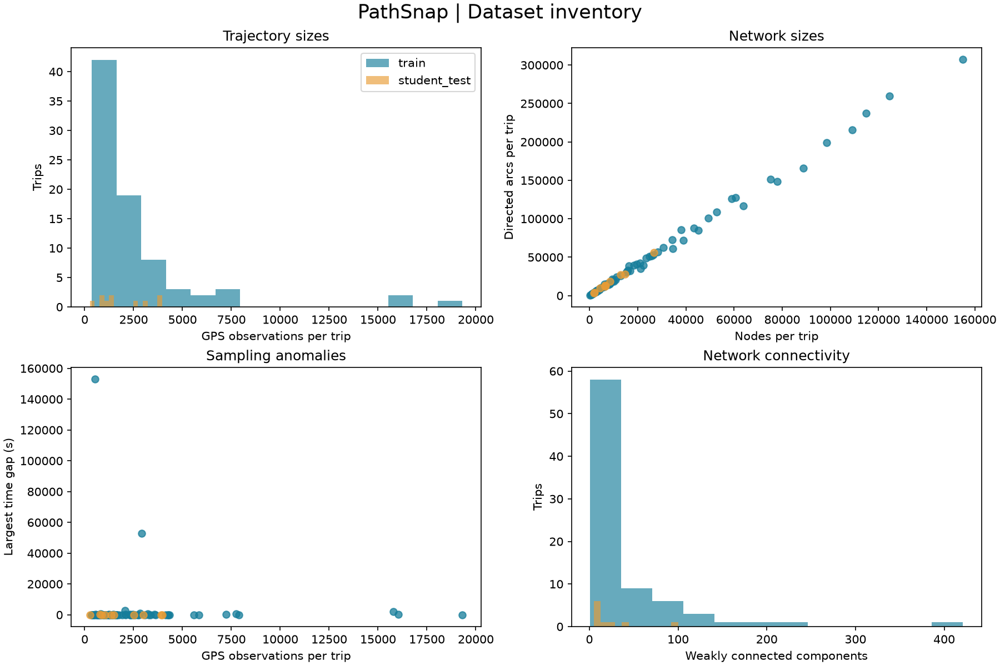
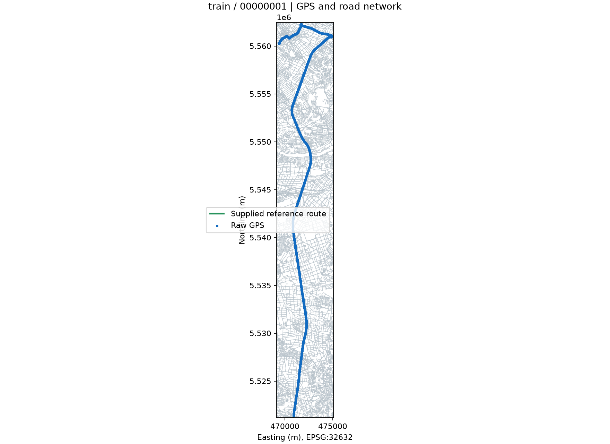
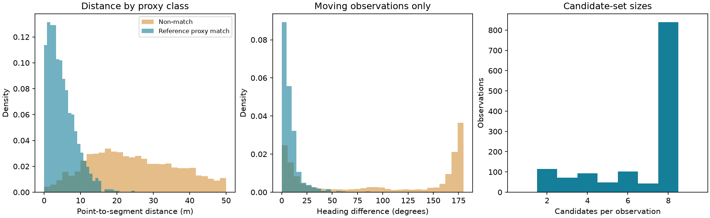

# Dataset understanding and EDA findings

Generated 18 November 2026 from a full development-data run. No evaluator data was used.

## Dataset size

| partition | trips | gps | nodes | arcs | reference_arcs |
| --- | --- | --- | --- | --- | --- |
| student_test | 10 | 19160 | 90689 | 185041 | 3477 |
| train | 80 | 208417 | 1933485 | 3876904 | 31336 |

All 360 raw files were parsed and validated. Their combined size is
94,106,043 bytes. Node/arc totals sum trip-local networks;
they must not be interpreted as globally unique roads. There are 227,577
GPS observations. The largest trip has 19,313 observations;
the largest network has 307,392 directed arcs.

## Data quality and topology

| partition | missing_values | invalid_coordinates | duplicate_timestamps | backward_timestamps | gaps_over_10s | self_loops | duplicate_arcs | reference_route_breaks |
| --- | --- | --- | --- | --- | --- | --- | --- | --- |
| student_test | 0 | 0 | 0 | 0 | 27 | 2 | 128 | 1 |
| train | 0 | 0 | 0 | 0 | 590 | 22 | 1775 | 13 |

96.682% of adjacent timestamp differences are exactly one second.
The largest observed gap is 153,064 seconds. Such gaps must
reset motion/decoder assumptions. No observations were silently reordered or
interpolated. 0 observations were rejected by preprocessing.

The trip coordinates span longitude -100.418538 to
137.237029, latitude -34.640291 to
61.699590. A single local CRS would be inappropriate;
per-trip UTM projections are used. Weak connectivity varies by trip, and directed
reachability cannot be inferred from weak-component membership alone.

Duplicate arcs and self-loops retain original IDs. Zero-length arcs are excluded
from candidates. 14 consecutive reference-arc pairs
are disconnected by directed endpoint identity; no artificial connecting arcs are created.

## Candidate features and reference coverage

Default policy: exact segment distance, radius 50 m, maximum 8 candidates, nearest
fallback flagged when the radius contains none. All 23 model inputs are reference-free.

| partition | clean_observations | candidate_rows | usable_proxy_labels | candidate_misses | training_eligible_observations | proxy_miss_rate_percent | mean_candidates |
| --- | --- | --- | --- | --- | --- | --- | --- |
| student_test | 19160 | 113648 | 14472 | 15 | 14457 | 0.104 | 5.932 |
| train | 208417 | 1124837 | 145069 | 726 | 144343 | 0.5 | 5.397 |

Candidate miss rate is computed only among usable **approximate reference proxy
labels**, not independently timestamped ground truth. Reference information is
never injected into candidates or inference features. Unusable labels and misses
are excluded from the eligible candidate-classifier training join.

| partition | usable_proxy_labels | far_reference_observations | ambiguous_observations | speed_outliers |
| --- | --- | --- | --- | --- |
| student_test | 14472 | 27 | 4660 | 1 |
| train | 145069 | 23343 | 39856 | 150 |

## Reference alignment diagnostic

Monotone route alignment can increase distance relative to independently choosing
the nearest reference arc. The following independent STRtree check quantifies both:

| partition | nearest_reference_over_50m | aligned_reference_over_50m | additional_far_after_alignment |
| --- | --- | --- | --- |
| student_test | 27 | 27 | 0 |
| train | 22576 | 23343 | 767 |

Trips with the largest number of observations over 50 m from **any** supplied reference arc:

| partition | trip_id | observations | nearest_reference_over_50m | additional_far_after_alignment |
| --- | --- | --- | --- | --- |
| train | 00000054 | 19313 | 16849 | 537 |
| train | 00000033 | 5844 | 3445 | 4 |
| train | 00000002 | 7243 | 868 | 0 |
| train | 00000084 | 16031 | 593 | 0 |
| train | 00000066 | 4325 | 187 | 203 |

These observations cannot be made reliable by merely assigning a row-wise route
label. The discrepancy may reflect reference coverage, GPS quality or reference
limitations; these data alone do not establish its cause. Additional alignment
distance is an algorithmic limitation, reported separately rather than attributed
entirely to the raw data.

## Training-trip candidate sensitivity

The study below uses the first training trip only. It is a reproducible sensitivity
check, not a claim that the selected defaults are optimal for all trips.

| radius_m | max_candidates | rows | usable_proxy_observations | proxy_miss_percent | fallback_observations |
| --- | --- | --- | --- | --- | --- |
| 25.0 | 4 | 4208 | 1104 | 0.906 | 0 |
| 25.0 | 8 | 5722 | 1104 | 0.091 | 0 |
| 25.0 | 12 | 6221 | 1104 | 0.091 | 0 |
| 50.0 | 4 | 4958 | 1104 | 0.906 | 0 |
| 50.0 | 8 | 8698 | 1104 | 0.091 | 0 |
| 50.0 | 12 | 11292 | 1104 | 0.0 | 0 |
| 100.0 | 4 | 5205 | 1104 | 0.906 | 0 |
| 100.0 | 8 | 10062 | 1104 | 0.091 | 0 |
| 100.0 | 12 | 14507 | 1104 | 0.0 | 0 |

## Visual evidence

Interactive maps: [training trip](../results/member1/train_00000001_raw_map.html)
and [student-test trip](../results/member1/student_test_00000000_raw_map.html).
Each has GPS, road-network and reference-route layers, a legend and layer controls.
These maps are development EDA, not the evaluator-facing UI.

## Implications for the next workstreams

Use trip-grouped cross-validation; retain the student-test partition for development
comparison. Fit scalers only on training folds. Evaluate observation-level ranking
and candidate coverage alongside candidate-level classification metrics. Retain
the candidate-to-arc mapping for the learned decoder, reset at gaps, and handle
disconnected road transitions explicitly. Report proxy-label exclusions and avoid
claiming pointwise ground-truth accuracy without explaining the alignment policy.
