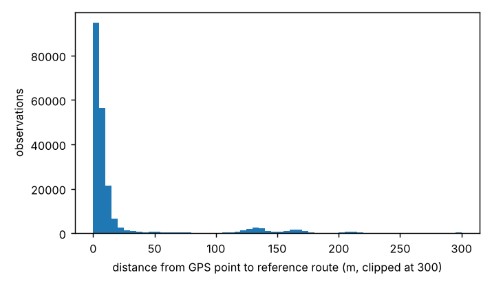
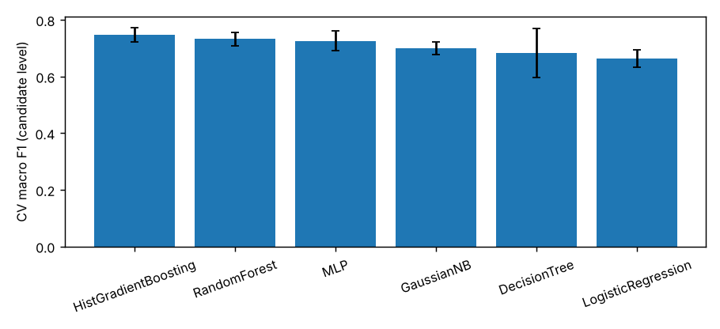
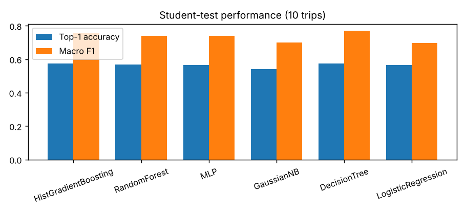
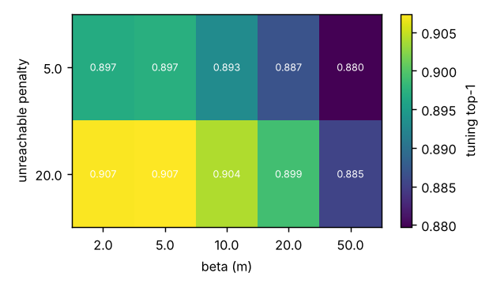
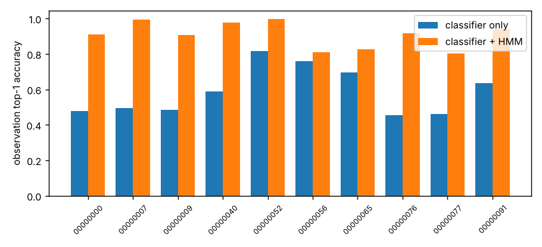

> **Read before use.** This draft was produced with AI assistance. Every number in it is generated by the code in the repository, and the tables are built from the result files in `results/`. Before submission, every team member must (1) re-run the scripts and confirm the numbers, (2) rewrite the analysis in their own words, (3) explain every model, plot and design choice in the viva, and (4) disclose AI assistance as the event's policy requires. Sections 2.2 and 3–6 are technical drafts only; the team's own interpretation is required.

# 1. Problem and scope of this report

GPS observations are noisy, sparse and sometimes missing. The task is to match each observation to a road segment (arc) and to rebuild a connected route. This report covers the **model-experimentation part** of the system (candidate classification, model comparison, Bayesian hyperparameter optimisation and HMM/Viterbi route reconstruction), together with the Folium maps, API and UI that the pipeline needs for evaluation.

Data partitions used in this report:

| Partition | Trips | Used for |
|---|---|---|
| Training | 80 | candidate generation, cross-validation (5-fold GroupKFold by trip), Bayesian search (3-fold), HMM decoder tuning (out-of-fold probabilities, 14 trips) |
| Student testing | 10 | development-stage model comparison and final decoder comparison |
| Evaluator testing | 10 | **not available to this work**; the API is written for it but has not been run on it |

No trip is split across partitions. Evaluator labels were never read.

# 2. Dataset understanding and exploratory data analysis

## 2.1 Raw data and preprocessing

* **Files:** `.track` (lon, lat, timestamp), `.nodes` (lon, lat), `.arcs` (from node, to node; the row index is the arc ID), `.route` (ordered reference arc IDs). Every trip has all four files.
* **Projection:** coordinates are projected to metres with an azimuthal-equidistant projection centred on each trip, so all distances are physical distances.
* **Quality checks:** no NaN or infinite values; timestamps strictly increasing in every trip.
* **Sampling:** 96.5% of training steps are exactly 1 s apart and 98.6% of student-test steps are (the guide says "about 97%").
* **Gaps:** the training set has 133 steps longer than 30 s; the longest is 153,064 s (about 42.5 hours). The student-test set has 2 such steps (longest 210 s). The HMM breaks chains at gaps longer than 30 s.
* **Two arc directions:** 82.4% of arcs have a reverse twin in the sample trip we checked, so the decoder uses directed shortest paths.

Dataset inventory (from `results/data/dataset_inventory.json` and `trip_stats_*.csv`):

| Partition | Trips | GPS observations | Candidate rows (K = 10) | Median road arcs / trip | Median reference-route arcs | Candidate miss rate |
|---|---|---|---|---|---|---|
| Training | 80 | 208,417 | 2,084,170 | 19,527 | 280 | 7.26% (0.80% excluding trips 00000033 and 00000054) |
| Student test | 10 | 19,160 | 191,600 | 13,145 | 250 | 0.20% |

## 2.2 Candidate generation and features

For each GPS observation we keep the **K = 10 road arcs nearest to it** (point-to-segment distance). Candidates are found with a k-d tree over five sample points per arc, which keeps the search fast on networks with more than 300,000 arcs. Candidate generation uses no labels.

Features per (observation, candidate) pair:

| Feature | Meaning |
|---|---|
| `d` | perpendicular distance from GPS point to arc (m) |
| `d_rel` | `d` minus the nearest candidate's distance |
| `rank` | rank of the candidate by distance |
| `t_param`, `dist_start`, `dist_end` | position of the projection along the arc |
| `arc_len` | arc length (m) |
| `cos_heading`, `heading_deg` | angle between the local track direction and the arc (undirected) |
| `speed` | local speed from neighbouring observations (m/s) |
| `dt_prev`, `dt_next` | time to previous and next observation (s, capped at 60) |
| `deg_from`, `deg_to` | node degree at each end of the arc (junction complexity) |
| `n_cands` | number of candidates for the observation |

**Reference label.** The `.route` file gives an ordered list of arcs, not one label per point. We label each observation with the **nearest reference-route arc**, and a candidate is positive when it equals that arc. This is a modelling choice, and it affects every metric.

## 2.3 Patterns observed in exploration

* **Candidates usually contain the right answer.** The true arc is among the candidates for 99.8% of student-test observations. The difficulty is choosing among them. Typical GPS error to the reference route is small: median 5.6 m, 90th percentile 74.8 m, 99th percentile 203.7 m (training set; `eda_reference_distance.png`). 10.8% of training observations are more than 50 m from the reference route.
* **Two training trips have offset reference routes.** Trips 00000033 and 00000054 have 66% and 51% candidate-miss rates. Their GPS points sit a consistent 122 m and 139 m (median) from the reference route, which points to a bad or offset reference route rather than noisy GPS (`eda_worst_reference_trips.png`). We kept them in the main experiments and report their effect here. Excluding them would lower the training miss rate from 7.26% to 0.80%, but we did not filter training data on label-based criteria.
* **Trips vary a lot in size.** Observations per trip range from 262 to 19,313, and road networks range from about 300 to 155,000 nodes (`eda_trip_overview.png`). Trip 00000054 (19,313 observations) is the largest in training.

Figures: `results/plots/eda_trip_overview.png`, `eda_reference_distance.png`, `eda_worst_reference_trips.png`, `trip_train_00000010.png`, `trip_student_test_00000000.png`.

# 3. Model experimentation and comparison

## 3.1 Overall comparison

Six model families were trained. **Cross-validation** (GroupKFold, 5 folds, by trip) was run on the 80 training trips. **Student-test** scores come from refitting each model on all 80 training trips and scoring the 10 student-test trips. Metric definitions are in `src/pathsnap/metrics.py`.

| Model | Family | CV Macro F1 (mean ± sd) | CV Top-1 | Student-test Top-1 | Student-test Macro F1 | Student-test Log Loss | Route continuity (test) | Inference (s / 1k obs) |
|---|---|---|---|---|---|---|---|---|
| **HistGradientBoosting** (selected) | Boosting | **0.7464 ± 0.0251** | 51.76% | 57.44% | 0.7563 | 0.1433 | 93.04% | 0.0482 |
| RandomForest | Ensemble (bagging) | 0.7326 ± 0.0240 | 51.84% | 56.79% | 0.7400 | 0.1403 | 93.08% | 0.0568 |
| MLP | Neural network | 0.7260 ± 0.0359 | 51.43% | 56.43% | 0.7399 | 0.1455 | 93.02% | 0.1492 |
| GaussianNB | Probabilistic | 0.6999 ± 0.0222 | 48.51% | 53.94% | 0.6994 | 0.6489 | 92.80% | 0.0082 |
| DecisionTree | Tree | 0.6825 ± 0.0857 | 51.46% | 57.35% | 0.7707 | 0.1431 | 93.00% | 0.0028 |
| LogisticRegression | Linear | 0.6641 ± 0.0301 | 51.06% | 56.56% | 0.6954 | 0.1673 | 92.79% | 0.0038 |

Selection rule (fixed before the search): the model with the highest mean 5-fold CV candidate macro F1 on the training trips. HistGradientBoosting was selected (0.7464). We did not select by student-test or training scores. The decision tree has the highest student-test macro F1 (0.7707) but ranks below on CV, which is why CV, not student-test, drives selection.

Note on the top-1 column: the classifier chooses one candidate per observation with no sequence information, so observation-level top-1 stays near 52–57% for every model. That is the reason for the HMM stage (Section 5).

## 3.2 Questions for each model

For each model, the answers below are drawn from our measured results. The strength and weakness statements are conclusions from those results, not general textbook descriptions. Training-set scores come from `results/metrics/train_cv_test_gap.csv`, computed with the saved models.

### 3.2.1 HistGradientBoosting (selected)

1. **Why suitable.** Candidate rows are tabular with mixed scales and non-linear interactions (for example, distance combined with heading and junction degree). Gradient-boosted trees model these interactions well and handle the 2 million-row training table efficiently.
2. **Strengths and limitations.** Highest CV macro F1 and fast inference (0.048 s per 1,000 observations). Limitation: it treats each candidate independently and cannot see neighbouring observations, which is why the decoder is needed. Its training-trip top-1 (57.4%) is about 5.7 points above its CV top-1 (51.8%), so it overfits somewhat.
3. **Important hyperparameters (initial values).** learning rate 0.1, `max_iter` 200, `max_leaf_nodes` 31, `min_samples_leaf` 20, `l2_regularization` 0, early stopping on a 10% validation split.
4. **Loss / objective.** Binary log loss (logistic loss) with second-order (Newton) gradient boosting.
5. **Student-test performance.** Top-1 57.44%, macro F1 0.7563, log loss 0.1433.
6. **Overfitting or underfitting.** Mild overfitting: a 5.7-point gap between training top-1 (57.4%) and CV top-1 (51.8%). Log loss is 0.123 on training trips and 0.161 in CV. Test scores are close to CV, so the gap does not get worse on unseen trips.

### 3.2.2 RandomForest

1. **Why suitable.** Bagged trees are a stable, non-linear baseline and need little tuning; this was the strongest bagging-based candidate.
2. **Strengths and limitations.** Stable log loss (0.140 on test) but slow to train (about 25 s per fold on two cores, even with 25% bootstrap sampling). Limitation: it overfits the most of the six models (training top-1 59.7% vs CV top-1 51.8%, a gap of 7.9 points).
3. **Hyperparameters.** 40 trees, `max_depth` 14, `min_samples_leaf` 10, `max_samples` 0.25 (reduced from 60 trees and no subsampling to fit the 2-CPU, 7 GB environment).
4. **Loss / objective.** Gini impurity per split; probability = average leaf class frequency.
5. **Student-test performance.** Top-1 56.79%, macro F1 0.7400, log loss 0.1403.
6. **Overfitting or underfitting.** Overfitting, as stated above.

### 3.2.3 MLP (neural network)

1. **Why suitable.** A small feed-forward network can learn non-linear feature combinations without manual interaction terms. Scaled features matter for this model, so it sits behind a `StandardScaler`.
2. **Strengths and limitations.** Competitive CV macro F1 (0.726 ± 0.036; the largest fold-to-fold spread among the stronger models). Slowest inference (0.149 s per 1,000 observations). Limitation: the training run hit the 15-epoch limit before converging (sklearn `ConvergenceWarning`), so these numbers are for a short, unconverged training run.
3. **Hyperparameters.** hidden layers (64, 32), Adam optimiser, learning rate 0.001 (sklearn default), L2 `alpha` 1e-4 (default), `max_iter` 15, early stopping with `n_iter_no_change` 5.
4. **Loss / objective.** Cross-entropy (log loss) minimised with Adam.
5. **Student-test performance.** Top-1 56.43%, macro F1 0.7399, log loss 0.1455.
6. **Overfitting or underfitting.** Training top-1 57.3% vs CV 51.4% (gap 5.9 points). Epoch-wise training and validation curves are in `results/plots/mlp_training_curves.png`; they are the only epoch-wise histories in this report, so no other model has a training-curve figure.

### 3.2.4 DecisionTree

1. **Why suitable.** A single tree is an interpretable non-linear rule set, and its cost is very low.
2. **Strengths and limitations.** Fastest inference of the six models (0.003 s per 1,000 observations) and the best student-test macro F1 (0.7707). Limitation: the most unstable across folds (CV macro F1 0.682 ± 0.086). Folds 0 and 4 score 0.576 and 0.603, while folds 1 to 3 score 0.738 to 0.757. We have not yet checked which trips fall in the weak folds, so the cause is unconfirmed. This instability is the main reason it is not selected.
3. **Hyperparameters.** `max_depth` 10, `min_samples_leaf` 20.
4. **Loss / objective.** Gini impurity.
5. **Student-test performance.** Top-1 57.35%, macro F1 0.7707, log loss 0.1431.
6. **Overfitting or underfitting.** Moderate overfitting (training top-1 56.2% vs CV 51.5%; training log loss 0.123 vs CV 0.187).

### 3.2.5 LogisticRegression

1. **Why suitable.** A linear probabilistic baseline. It shows how far a linear decision boundary gets on these features.
2. **Strengths and limitations.** Very fast at inference (0.004 s per 1,000 observations). Its test log loss (0.167) is worse than the tree and boosting models. Limitation: the lowest CV macro F1 of the six (0.664), and no gap between training and CV, which indicates underfitting: the features do not separate the true arc from its neighbours linearly.
3. **Hyperparameters.** `C` = 1.0, lbfgs solver, `max_iter` 300, features standardised.
4. **Loss / objective.** L2-regularised logistic (log) loss.
5. **Student-test performance.** Top-1 56.56%, macro F1 0.6954, log loss 0.1673.
6. **Overfitting or underfitting.** Underfitting (training top-1 51.1%, CV 51.1%, with almost no gap).

### 3.2.6 GaussianNB

1. **Why suitable.** A probabilistic baseline with almost no training cost, to check whether independent Gaussian features are enough.
2. **Strengths and limitations.** Fastest to train and very fast at inference. Limitation: the features are clearly not Gaussian and not independent (for example, `dist_start` and `dist_end` add up to the arc length), so its probabilities are badly calibrated (log loss 0.649 on test vs 0.14 for the best models).
3. **Hyperparameters.** `var_smoothing` 1e-9 (default).
4. **Loss / objective.** Gaussian likelihood under the naïve independence assumption.
5. **Student-test performance.** Top-1 53.94%, macro F1 0.6994, log loss 0.6489.
6. **Overfitting or underfitting.** Underfitting (training top-1 48.7% vs CV 48.5%).

## 3.3 Visualisations

* CV macro F1 comparison, mean and standard deviation over folds: `results/plots/cv_macro_f1_comparison.png`
* Student-test top-1 and macro F1: `results/plots/student_test_top1_f1.png`
* Student-test log loss: `results/plots/student_test_logloss.png`
* Confusion matrix of the selected model on student-test candidates: `results/plots/confusion_HistGradientBoosting_tuned.png`
* MLP training and validation curves: `results/plots/mlp_training_curves.png` (MLP only, since it is the only model with an epoch-wise history)

# 4. Bayesian hyperparameter optimisation (selected model)

**Method.** Optuna's Tree-structured Parzen Estimator (a Bayesian optimiser) was run for 20 trials. The objective was the mean candidate-level macro F1 over 3 GroupKFold folds of the training trips. The student-test set was not used to choose anything. The full search record is in `results/metrics/optuna_trials.csv`.

**Search space.**

| Hyperparameter | Range | Scale |
|---|---|---|
| learning_rate | 0.02 – 0.30 | log-uniform |
| max_leaf_nodes | 8 – 128 | log-uniform integer |
| min_samples_leaf | 20 – 400 | log-uniform integer |
| l2_regularization | 1e-6 – 10 | log-uniform |
| max_iter | 100 – 400 | uniform integer |

**Answers.**

1. *Hyperparameters searched:* the five listed above.
2. *Ranges:* as listed. They were chosen around scikit-learn's defaults so the search covers both sides of the default settings.
3. *Objective:* mean 3-fold group-CV candidate macro F1 on training trips.
4. *Trials:* 20, taking 1,066 s (about 18 minutes) in total.
5. *Best values:* learning_rate 0.1786, max_leaf_nodes 18, min_samples_leaf 26, l2_regularization 0.0616, max_iter 232.
6. *Did the tuned model outperform?* On the search objective, yes, slightly. The result is mixed on the other metrics, as the comparison below shows.

| Metric | Untuned (defaults) | Tuned | Comparison |
|---|---|---|---|
| 3-fold CV candidate macro F1 (objective) | 0.7442 | 0.7499 | tuned higher (+0.0057) |
| 3-fold CV observation top-1 | 51.75% | 51.53% | tuned slightly lower |
| Student-test observation top-1 | 57.44% | 57.07% | tuned slightly lower |
| Student-test candidate macro F1 | 0.7563 | 0.7654 | tuned higher |
| Student-test log loss | 0.1433 | 0.1424 | tuned slightly better |
| Student-test route continuity | 93.04% | 93.07% | essentially equal |
| Inference time (s / 1k obs) | 0.0482 | 0.0350 | tuned faster |

The differences are small. Tuning improved the search objective and the probability quality (log loss and macro F1), but it did not improve top-1 accuracy. Because the objective is macro F1 at a fixed 0.5 threshold, it rewards calibration as well as ranking. Trial 2 (macro F1 0.688, top-1 0.518) shows how strongly the score depends on the threshold. A ranking-based objective such as top-1 might give a different optimum, and we did not test that.

**Final model decision.** The tuned model was frozen as the final classifier, because it met the selection rule that was fixed in advance (higher 3-fold CV macro F1 than the untuned model). The HMM decoder was then re-tuned on the tuned model's out-of-fold probabilities (`scripts/07_finalize_tuned.py`), so the decoder is consistent with the model that is deployed. The untuned-classifier HMM results are kept as an ablation in `results/metrics/untuned_clf_*`.

# 5. HMM and Viterbi route reconstruction

## 5.1 Method

* **Hidden states.** At observation *i*, the states are the K = 10 candidate arcs for that observation, so each state keeps its link to a road segment.
* **Emission.** `log(p_c / Σ p_c')`, where p_c is the classifier's probability for candidate *c*, normalised over the observation's candidates.
* **Transition.** For candidates *a* (observation *i*−1) and *b* (observation *i*), the route distance `rd` is the distance travelled along the directed road network from the projected point on *a* to the projected point on *b*, found with Dijkstra's algorithm with a cut-off. For the same arc, it is the distance along that arc. The transition score is `−|rd − gc| / β`, where `gc` is the straight-line distance between the two observations (Newson–Krumm style).
* **Missing candidates and invalid transitions.** If *b* cannot be reached from *a* within the cut-off, the transition gets a fixed penalty (`unreachable_penalty`), so a route can still be decoded when the network has a gap. An observation with no candidates breaks the chain and receives no prediction (`-1`).
* **Large GPS gaps.** Chains are split at time gaps above 30 s, and at implied speeds above 40 m/s. Each chain is decoded separately.
* **Disconnected segments.** If consecutive observations suggest disconnected arcs, the penalty makes such transitions unlikely, but Viterbi still returns the best-scoring path. The continuity metric below records any remaining jumps.

## 5.2 Tuning (training trips only)

The decoder has two parameters, β and `unreachable_penalty`. They were tuned on 14 training trips (every sixth trip), using out-of-fold probabilities from the tuned model, so no training trip was scored by a model that had seen it. The student-test set was used only for the final comparison.

| β (m) | Unreachable penalty | Tuning top-1 (%) | Tuning seq F1 (%) | Tuning continuity (%) |
|---|---|---|---|---|
| **5.0 (selected)** | **20.0** | **90.74** | **90.61** | **97.53** |
| 2.0 | 20.0 | 90.72 | 90.99 | 97.58 |
| 10.0 | 20.0 | 90.41 | 90.21 | 97.45 |
| 20.0 | 20.0 | 89.90 | 89.32 | 97.35 |
| 5.0 | 5.0 | 89.72 | 89.35 | 97.32 |
| 50.0 | 5.0 | 87.97 | 86.17 | 96.79 |

The top-2 settings are almost tied (β = 5 and β = 2, both with penalty 20; 90.74% vs 90.72%). We chose β = 5 because it has the highest top-1. A larger penalty helped at every β, and β values above 20 m hurt. Frozen configuration: β = 5 m, penalty 20, gap threshold 30 s, maximum speed 40 m/s, search bound 3 × gc + 300 m (`models/hmm_config.json`). Figure: `results/plots/hmm_tuning_grid.png`.

## 5.3 Results on the student-test set

**Classifier-only versus classifier + HMM (10 student-test trips, 19,160 observations).**

| Method | Observation top-1 | Route continuity | Sequence precision | Sequence recall | Sequence F1 |
|---|---|---|---|---|---|
| Classifier only | 58.73% | 91.19% | 54.71% | 77.49% | 63.42% |
| Classifier + HMM/Viterbi | **90.82%** | **97.81%** | **93.42%** | **89.68%** | **91.31%** |

Sequence precision, recall and F1 compare the set of distinct arcs in the predicted route with the reference route's arcs. Route continuity is the share of consecutive predicted arcs that are the same or share a road node.

**Per trip.**

| Trip | Observations | Classifier top-1 | HMM top-1 | Classifier seq F1 | HMM seq F1 | HMM chain breaks |
|---|---|---|---|---|---|---|
| 00000000 | 2,503 | 47.8% | 91.2% | 57.8% | 89.7% | 0 |
| 00000007 | 1,354 | 49.6% | 99.3% | 61.2% | 98.4% | 0 |
| 00000009 | 1,049 | 48.6% | 90.6% | 53.9% | 87.0% | 0 |
| 00000040 | 2,995 | 58.8% | 97.6% | 67.8% | 97.4% | 0 |
| 00000052 | 262 | 81.7% | 99.6% | 70.1% | 93.3% | 0 |
| 00000056 | 3,958 | 76.0% | 80.8% | 78.0% | 93.0% | 0 |
| 00000065 | 768 | 69.5% | 82.8% | 75.2% | 91.7% | 1 |
| 00000076 | 1,486 | 45.4% | 91.9% | 50.5% | 84.8% | 1 |
| 00000077 | 3,911 | 46.2% | 80.5% | 57.4% | 92.3% | 0 |
| 00000091 | 874 | 63.6% | 93.9% | 62.2% | 85.6% | 0 |

Figure: `results/plots/hmm_vs_classifier_per_trip.png`.

**Answers to the guide's questions.**

* *Did HMM decoding improve the final route?* Yes, on every student-test trip. Observation top-1 rises from 58.7% to 90.8%, and sequence F1 rises from 63.4% to 91.3%.
* *Where did it help least?* Trips 00000056 (76.0% → 80.8%) and 00000077 (46.2% → 80.5%) and 00000065 (69.5% → 82.8%) are the weakest HMM results. We have not diagnosed the cause for these trips. Plausible explanations to check are long parallel roads with similar distances to the GPS points, and GPS offset from the network. Trips 00000056 and 00000077 are the longest in the test set (3,958 and 3,911 observations), so one of the two may be the cause. This needs a per-trip diagnosis before any claim is made.
* *Where did it not help?* It does not help when the classifier's probabilities are wrong for a whole stretch, because Viterbi can only choose among the candidates it is given. The candidate miss rate on the student-test set is 0.20%, so this is not the main limit.
* *Chain breaks.* Two breaks occurred in the student-test set (trips 00000065 and 00000076, one each). Both come from time gaps longer than 30 s.

**Ablation.** With the untuned classifier, the same decoder gave the results recorded in `results/metrics/untuned_clf_hmm_summary.json`. The conclusion is the same: the HMM is the main source of the gain.

# 6. Geographical visualisation with Folium (mandatory)

Interactive Folium maps are generated by `scripts/05_figures_maps.py` for two student-test trips: `results/maps/student_test_00000007.html` (the trip with the largest HMM gain) and `results/maps/student_test_00000000.html`. Each map has five layers, which can be toggled with the layer control:

* raw GPS observations (blue markers),
* the road network within the trip's extent (grey),
* the reference route (green, shown by default),
* the classifier-only route (orange, hidden by default),
* the classifier + HMM route (red, shown by default),

with a legend in the bottom-left corner. Arcs are tooltipped with their IDs.

**Still to do by the team:** the guide asks for a screenshot or exported view of at least one map in the PDF. We could not capture one in this environment, so please open one of the HTML files in a browser, take a screenshot, and insert it here. Static reference figures made with matplotlib are in `results/plots/trip_student_test_00000000.png` and `trip_train_00000010.png`. Those are plots, not Folium maps, and should not be submitted as the Folium requirement.

# 7. API, UI and deployment

**API (`api/app.py`, FastAPI).** Endpoints:

* `GET /health`: model name and decoder configuration.
* `GET /trips`: evaluator trip IDs only. No labels are returned.
* `POST /predict` with `{"trip_id": "..."}`: runs the prediction path on the raw trip (GPS and road network only), then loads the reference route on the server, scores the prediction, and returns both classifier-only and classifier + HMM metrics, the predicted route as coordinates, and the server time. The reference route is never sent to the client.

The prediction path (`src/pathsnap/pipeline.py`) does not load the reference route. Scoring against the reference is a separate function, so labels cannot leak into predictions. Each request is logged to `logs/api_requests.log` and to the console, as the evaluation requires.

**Testing.** The evaluator trips are not available to this work, so the API was tested on the student-test trips by setting `PATHSNAP_EVAL_PARTITION=student_test`. For trip 00000007 the server returned classifier-only top-1 49.6% and classifier + HMM top-1 99.3% in 0.41 s, matching the offline evaluation, and it logged the request. An unknown trip ID returned HTTP 404.

**UI (`ui/index.html`).** A single page that lists the evaluator trips, sends the selected trip ID to the API, and shows the metrics table and the predicted route on a Leaflet map. The UI never receives the reference route or the labels. **Not yet tested in a browser:** the page has not been opened or screenshotted in this environment. The team must test it, and the guide also requires screenshots of the working UI and of the API log on the receiving laptop.

**Deployment (two laptops).** Laptop 1 runs `uvicorn api.app:app --host 0.0.0.0 --port 8000` with `PATHSNAP_EVAL_ROOT` pointing at the evaluator data. Laptop 2 opens `ui/index.html` and sets the API base URL to Laptop 1's address. `requirements.txt` lists the dependencies.

# 8. Limitations and threats to validity

1. **Label definition.** Labels are the nearest reference-route arc, which is a proxy. Reference routes may be wrong, as trips 00000033 and 00000054 show. All accuracy figures depend on this definition.
2. **Two training trips with offset reference routes** are kept in training and CV. They lower CV top-1 for every model (the CV miss rate is 7.26%, or 0.80% without them).
3. **Macro F1 at a fixed 0.5 threshold** is sensitive to calibration, and it was the search objective. A different objective could change the chosen hyperparameters.
4. **Limited search.** Bayesian search used 20 trials, and the decoder grid used five values of β and two penalties. These are small budgets, and the gains in the tuning step were small.
5. **Decoder tuning subset.** The decoder was tuned on 14 of the 80 training trips to keep runtime reasonable, and the same frozen setting was then applied to the student-test set.
6. **Compute.** The environment had 2 CPUs and 7 GB RAM. The random forest was reduced to 40 trees with 25% bootstrap samples, and the MLP ran for 15 epochs, which was not enough to converge.
7. **Evaluator trips** were not used, so the API has not been tested on the real ten evaluation trips.

# 9. Reproducibility

Every number above is produced by the scripts in the repository, in order:

1. `scripts/01_build_features.py`: candidates and features; dataset inventory.
2. `scripts/02_train_compare.py`: six models, 5-fold CV, student test.
3. `scripts/04_bayes_opt.py`: Bayesian search and untuned baseline on the 3-fold objective.
4. `scripts/07_finalize_tuned.py`: out-of-fold probabilities for the tuned model and the frozen final model.
5. `scripts/03_hmm_eval.py`: HMM tuning on training trips and the student-test comparison.
6. `scripts/08_train_vs_test.py`: training-trip scores for overfitting analysis.
7. `scripts/05_figures_maps.py` and `scripts/06_report_tables.py`: figures, Folium maps and tables.

Random seeds are fixed to 42 for the models and the Optuna sampler. The 5-fold split is deterministic (GroupKFold).

# 10. Integrity and AI-use statement

[Team to complete: name the AI tools used, what they produced (code, this draft), and confirm that every team member has run the code, checked the results, and can explain the models, the decoder and the evaluation in the viva.]
